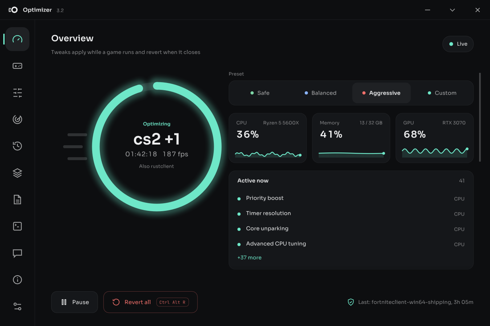
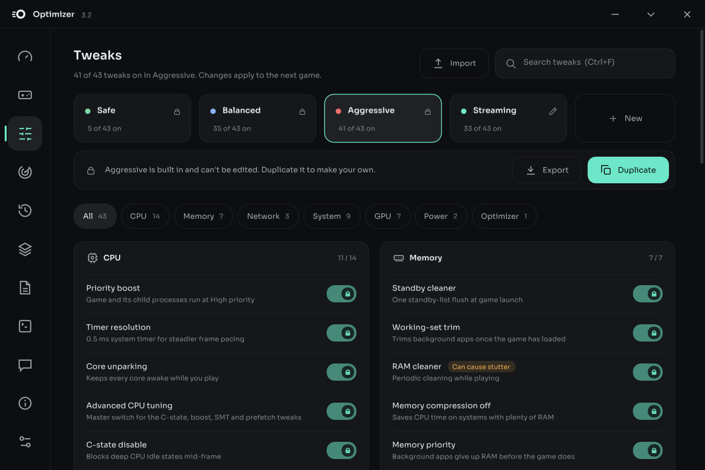
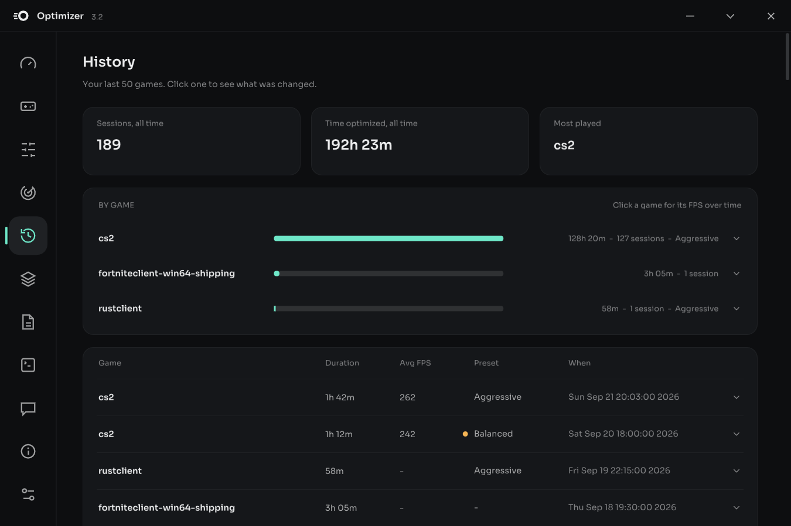

<h1 align="center">Optimizer</h1>

  A Windows game booster that tunes your PC while you play, and puts every setting back when you're done.

  <a href="https://github.com/passmedaoxy/optimizer/releases/latest/download/optimizer.exe"><b>Download optimizer.exe</b></a>
  &nbsp;·&nbsp;
  <a href="https://github.com/passmedaoxy/optimizer/releases">All releases</a>
  &nbsp;·&nbsp;
  <a href="https://github.com/passmedaoxy/optimizer/tree/archive">Archive of old builds</a>

  

## How it works

Optimizer sits in your tray and waits. When a game you've added starts, it applies the tweaks in your preset. When the game closes, it undoes every one of them and checks that each setting really went back. Your PC is only "optimized" while you're playing.

There are 43 tweaks, and every one explains what it does for performance and what it costs. A few examples:

- **CPU:** the game runs at high priority, cores stay awake, a finer system timer for steadier frame pacing, and background apps moved off the game's cores
- **Memory:** cached memory freed when the game starts, and background apps give up RAM before the game does
- **Network:** Nagle's algorithm off, the game's packets marked as high priority, and Wi-Fi background scanning paused
- **GPU:** NVIDIA Low Latency and AMD Anti-Lag, GPU priority, and windowed game optimizations
- **System:** apps you pick get closed (and reopened afterwards), Xbox Game Bar capture and services like Windows Search are paused, and the Ultimate Performance power plan is turned on

  

## Features

- **Presets:** Safe, Balanced and Aggressive, or make your own. Any game can use its own preset, or force single tweaks on or off.
- **Finds your games:** imports what you have installed on Steam, Epic, GOG, Xbox, Riot, Battle.net, EA, Ubisoft and Rockstar, and can spot new games as you play them.
- **Measures your FPS:** average FPS and 1% lows for every session, with a history and an FPS trend for each game.
- **Find my best preset:** plays your next few sessions of a game on different presets and keeps the one with the best 1% lows.
- **System checks:** flags things that cost FPS all the time, like RAM running below its rated speed (XMP / EXPO off), with one-click fixes you can undo.
- **Several games at once:** a second game that starts mid-session gets optimized too.
- **Panic button:** <kbd>Ctrl</kbd> + <kbd>Alt</kbd> + <kbd>R</kbd> reverts everything instantly.
- **Make it yours:** themes, accent colors, fonts and layout options.

  

## Safe by design

- **Everything goes back.** Each change is undone when the game closes or you quit, and checked afterwards.
- **Crashes and power cuts are covered.** Before changing a setting, Optimizer saves what it was. If your PC crashes or loses power mid-game, it puts everything back the next time it starts.
- **It never touches your games.** No game files are changed and nothing is injected into a game. Optimizer only changes Windows settings and process priorities.
- **Nothing is sent without you.** It checks GitHub for updates. Feedback and crash reports are only sent when you click Send.

## Getting started

1. [Download `optimizer.exe`](https://github.com/passmedaoxy/optimizer/releases/latest/download/optimizer.exe) and run it. Windows asks for administrator rights: Optimizer needs them to change system settings.
2. Add your games: **Games → Import games** finds the ones you have installed, or **Add game** for any other.
3. Pick a preset on the Overview page. **Balanced** is a good place to start.
4. Play. Optimizer does the rest.

Optimizer updates itself from the About page when a new version is out. Your settings live in `%LOCALAPPDATA%\Optimizer`. To remove it completely, type `uninstall` on the Output page: it undoes everything, including the System checks fixes, and deletes its files.

**Requirements:** Windows 10 or 11, 64-bit. An NVIDIA or AMD graphics card is only needed for the GPU-specific tweaks.

## About antivirus warnings

Optimizer changes system settings and isn't code-signed, which is exactly what some antivirus engines guess on. A couple of lesser-known engines on VirusTotal flag it as generic "malware". Windows Defender and the other big names don't. If yours does, it's a false positive, and System checks can add an exclusion for `optimizer.exe` (just that file, never its folder).

## Feedback

Found a bug or have an idea? Use the **Feedback** page in the app, or [open an issue](https://github.com/passmedaoxy/optimizer/issues).

## History

Optimizer started in January 2026 as a little Python script I made for myself, became something my friends used, got rewritten in C++, and turned into the app it is now. The old builds and the full story are on the [archive branch](https://github.com/passmedaoxy/optimizer/tree/archive).

## Credits

Built with [Dear ImGui](https://github.com/ocornut/imgui) and [nlohmann/json](https://github.com/nlohmann/json). GPU settings go through NVIDIA's NVAPI and AMD's ADLX. Fonts: Sora, Inter, Geist, Manrope, Outfit and JetBrains Mono (SIL Open Font License).
