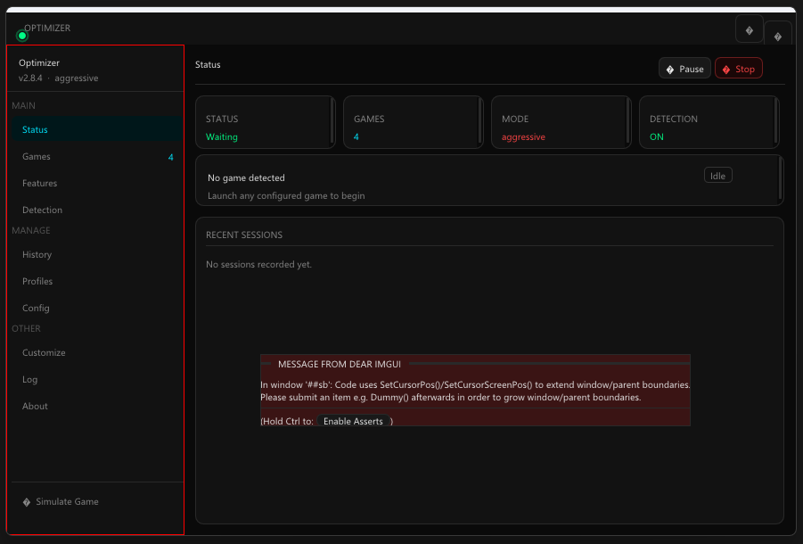

# Optimizer archive

Every old build of [Optimizer](https://github.com/passmedaoxy/optimizer) worth keeping (this is the `archive` branch), from the first Python script to the last console version. They're here for history and for fun. **None of them are supported**, and the current version is better and safer in every way: [get the latest release](https://github.com/passmedaoxy/optimizer/releases/latest).

> **Before you run any of these:** try them on a spare PC or a virtual machine. Old builds change Windows settings and don't always put everything back. Each zip has a `READ ME FIRST.txt` with what that version changes and how to undo it.

## How it started

Optimizer started as something I made just for myself: a small Python script that gave my games a little more priority while I played. v1.0 was the first build my friends tested, and it only knew a handful of games, written straight into the code.

v1.1 was the one me and my friends actually used day to day. It's where the hardcoded games went away: from then on, you added games yourself in JSON files, which was the only way it would find them. Everything from 1.1 to 1.4 was updates on top of that, making it work better and optimize more things.

2.0 was a rewrite in C++, because that's when I wanted to go open source. It was, for a little while, before I went closed source.

3.0 was planned for a while before it happened. The idea came to me around 2.8.3, and 2.8.4 even had a test build with a UI: my own HTML design, built into the app. It barely worked, if it worked at all (you couldn't even close it with its own close button), so it's not in this archive. After a good day on it, I gave up and scrapped it for the time being.

   
  The 2.8.4 UI test build in all its glory: missing icons, a debug outline left on, and an error box in the middle of the page.

What I really wanted was to make it friendly. Until then it was one of those apps you had to code, or spend a whole day learning, before you could use it. That's when I started on 3.0, and it became what it is now: an app for anyone on the internet who needs it. The builds below are from before that, kept so you can see where it came from.

## The builds

| Version | Date | What it was |
|---|---|---|
| [v1.0](https://github.com/passmedaoxy/optimizer/releases/tag/v1.0) | Jan 5, 2026 | The first build. A Python console script: high priority, 1 ms timer and Ultimate Performance while a game runs. |
| [v1.1](https://github.com/passmedaoxy/optimizer/releases/tag/v1.1) | Jan 7, 2026 | No more hardcoded games: you add them in JSON files. Also a tray icon. |
| [v1.4.2](https://github.com/passmedaoxy/optimizer/releases/tag/v1.4.2) | Feb 3, 2026 | The last Python version, first called Optimizer: commands, setup wizard, presets, closing apps, crash recovery, run on startup. |
| [v2.6.5](https://github.com/passmedaoxy/optimizer/releases/tag/v2.6.5) | Mar 6, 2026 | The C++ rewrite, still a console app, with around 40 tweaks. A Debug build: needs Visual Studio's C++ tools to run. |

The 1.x versions are Python programs packed with PyInstaller, so antivirus often flags them by mistake.

## Which games they work with

The early builds were made for me and my friends, not for public use, so the first ones only work with certain games.

| Version | Games |
|---|---|
| v1.0 | Only these 7, built in: Counter-Strike 2, VALORANT, Fortnite, Rust, Escape from Tarkov, Roblox, and Minecraft (the launcher and the Windows edition). |
| v1.1 | None built in. It reads `games.json` in `%LOCALAPPDATA%\FPSOptimizer`, which starts empty, so you add games by hand (by exe name, like `"cs2.exe": { "timer": true }`). |
| v1.4.2 | Any game you add: the setup wizard asks for its exe name (like `cs2.exe`), or use `addgame` later. |
| v2.6.5 | Any game you add: the setup wizard asks for its exe name (like `cs2.exe`), or use `addgame` later. VALORANT gets special handling for its anti-cheat. |

> **Only these builds survived.** The versions in between, and everything else from before 2.8.3, are lost to time.

Thanks for reading this far. I might go open source again soon: we need more optimization apps that people can actually use.
